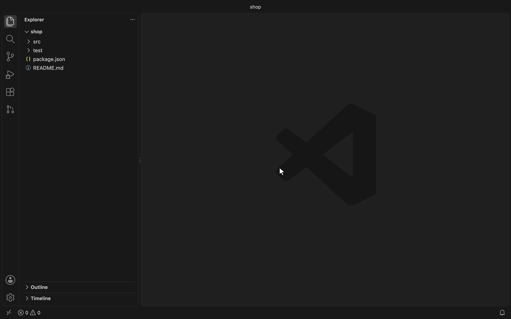
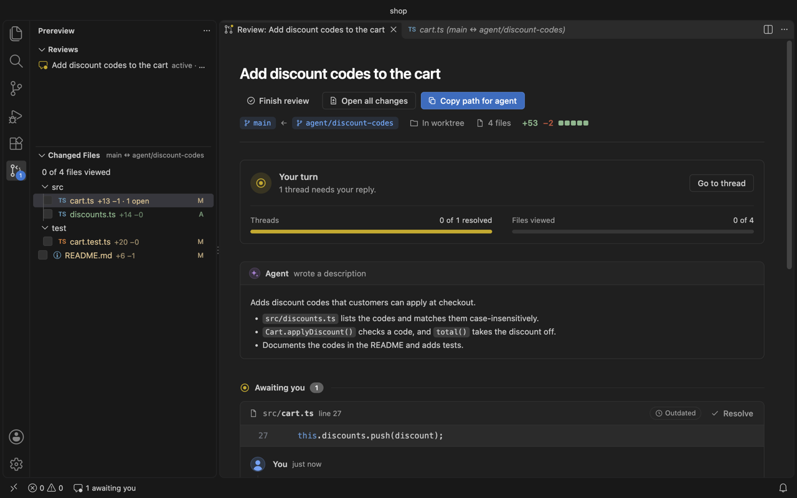
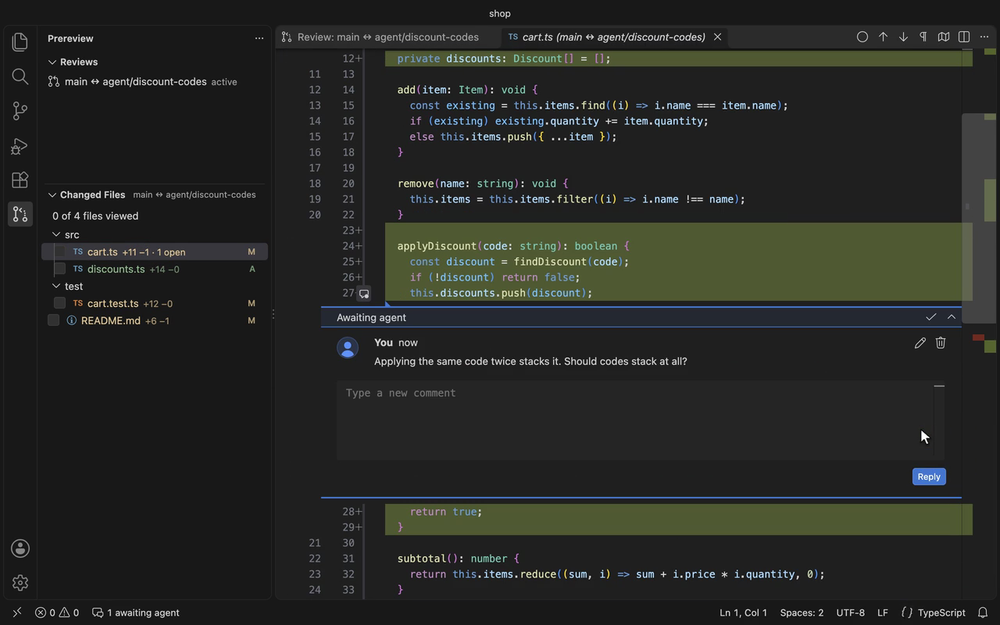

<p align="center">
  
</p>

<h1 align="center">Prereview</h1>

<p align="center"><strong>Review your agent's code like a pull request, before there is one.</strong></p>

<p align="center">
  <a href="https://github.com/MariSchn/Prereview/actions/workflows/ci.yml"></a>
  <a href="LICENSE"></a>
</p>

Comment on your coding agent's changes inside VS Code or Cursor, send the review back, and read the reply in the same thread. Nothing is pushed, and there is no pull request.

<p align="center">
  
</p>

## Why

Reviewing agent output usually means one of two things. You push a branch and open a pull request, which runs CI and leaves unfinished work in your history. Or you read a raw diff and type your comments into the chat, where they get detached from the lines they were about.

Prereview is the review step without the pull request. The comments live on the lines, the agent replies in the same file, and the editor updates as it writes.

## Install

Download `prereview-0.1.0.vsix` from [Releases](https://github.com/MariSchn/Prereview/releases). Then either:

- open the Extensions view, click **⋯**, and choose **Install from VSIX…**, or
- run this in a terminal:

```sh
code --install-extension prereview-0.1.0.vsix
```

In Cursor, use `cursor --install-extension` instead of `code`.

Prereview needs VS Code 1.99 or later and a local git repository. It is not published to the Marketplace or Open VSX.

## Use

1. Open **Prereview** in the activity bar and click **Start Review**. Pick the base branch, or type any commit, tag or `HEAD~3`, then what to compare it with. Branches checked out in other worktrees, such as an agent's, are also offered under **Reviews** as one-click reviews.
   - **Working tree** is the branch you have open, plus uncommitted changes.
   - **Another branch** shows that branch's commits. If the branch is checked out in another worktree, for example an agent's, the review includes that worktree's uncommitted changes, and you can edit the code right in the diff.
2. The overview works like a pull request's Conversation tab. It shows the title and description, every thread, and a box for a general comment.
   - To have an agent review the changes before you do, click **Copy prompt for review agent** in the overview and paste it into that agent, or use **Send to Review Agent Terminal**. Both are also in the **⋯** menu of **Changed Files**. The review agent's comments show up as threads waiting on you. Reply to the ones you want addressed and resolve the rest; the agent that made the change only takes up the ones you replied to. Change the prompt with the `prereview.reviewAgentPrompt` setting.
3. **Changed Files** lists the diff as a tree, with additions and deletions. Lock files and generated files are grouped at the end. Click a file to open it. Tick a file, or a whole folder, once you have reviewed it, or press <kbd>Ctrl</kbd>+<kbd>Alt</kbd>+<kbd>V</kbd> (<kbd>Cmd</kbd>+<kbd>Alt</kbd>+<kbd>V</kbd> on a Mac) in its diff to tick it and open the next file. If it changes after that, it is unticked, and **Open Changes Since Viewed** (in the file's row, the diff's title bar and the overview) shows only the new part. **Open All Changes Since Viewed** shows them for every such file at once. **Hide Viewed Files** and **Open Changes Not Yet Viewed** narrow it down to what's left.
4. Hover the line numbers in a diff and click **+** to comment. Drag to cover a range. You can also comment on a whole file, on a deleted line, or on the change as a whole. Resolve a thread when you are done with it.
   - Start a comment with `nit:`, `question:` or `blocking:` to tell the agent how much it matters.
   - Put the code you want in a ```` ```suggestion ```` block, and the agent applies it as written. In a worktree you can also apply it yourself with **Apply suggestion**.
   - <kbd>Ctrl</kbd>+<kbd>Alt</kbd>+<kbd>J</kbd> and <kbd>K</kbd> (<kbd>Cmd</kbd> on a Mac) go to the next and previous open thread across files.
5. Click **Copy prompt for agent** and paste it into Claude Code, Codex, Cursor, or whichever agent made the change, or use **Send to Agent Terminal** to paste it into the terminal the agent runs in. The prompt is the review file's path with an instruction to address it; change it with the `prereview.agentPrompt` setting. The review file tells the agent how to reply.

   Replies show up on their own and are marked **New** until you look at the thread. File mentions like `src/cart.ts:27` in them open the diff. The badge on the Prereview icon counts threads waiting on you. **Open Changes Since Hand-Off** shows what the agent changed since you sent the review, and the history button on a thread shows what changed since your last comment in it.
6. **Finish review** deletes the review and its comments. To keep them, copy the review as Markdown first, from the same dialog or with **Copy Review as Markdown**.

You can keep several reviews at once, one per agent or branch. **Reviews** lists them with whose turn it is. Click one to switch.





## The review file

Each review is a JSON file in `.prereview/` at the repository root. A review of a branch checked out in another worktree is kept in that worktree's `.prereview/` instead, so an agent working there can write to it without asking for permission; it goes away when the worktree is removed. The folder ignores itself, so the files are not committed.

```json
{
  "agentInstructions": "...",
  "title": "Add discount codes to the cart",
  "description": "Adds discount codes that customers can apply at checkout.",
  "base": "main",
  "target": "agent/discount-codes",
  "threads": [
    {
      "id": "3f2a9c1b",
      "file": "src/cart.ts",
      "startLine": 27,
      "endLine": 27,
      "snippet": "this.discounts.push(discount);",
      "resolved": false,
      "comments": [
        { "id": "8d1e07aa", "author": "reviewer", "body": "Should codes stack?", "createdAt": "2026-10-18T12:00:00.000Z" },
        { "id": "c40b2f19", "author": "agent", "body": "No. A cart now holds a single code." }
      ]
    }
  ]
}
```

`target` is `null` for a working tree review. A thread with no line numbers is about the whole file, a thread with no `file` is a general comment, and `"side": "base"` puts the thread on the old version of the file. `file` is relative to the repository root and uses forward slashes.

The `agentInstructions` field, written into every file, tells the agent to fill in the title and description, reply to open threads, and leave the rest alone. An agent asked to review the changes instead opens a thread for each problem it finds, with `"author": "review agent"`. Prereview gives every comment an `id`, so the agent can leave it out.

Threads follow their code when lines are added or removed around it, also while you edit a file before saving it, and Prereview writes the current lines back to `startLine` and `endLine`. If the commented lines themselves change, or a line like `}` can't be told apart from its copies, the thread is marked **Outdated**.

Prereview keeps whatever it doesn't use, such as extra fields an agent adds. If the file isn't valid JSON, for example while the agent is still writing it, the overview says where the problem is, and your comments can't be saved until it is fixed.

## Privacy

Prereview stays on your machine. It does not have an account, a backend, or telemetry. It runs git locally, and the only files it writes are the review files and the snapshots it keeps so it can show what changed since you viewed a file. Those snapshots are git objects in the repository you are reviewing.

Markdown in the overview is rendered without scripts, and images from the network are blocked. The extension does not run in a workspace you have not trusted.

To report a vulnerability, use [GitHub security advisories](https://github.com/MariSchn/Prereview/security/advisories/new).

## FAQ

**Does it work in Cursor?**
Yes. Install the `.vsix` with `cursor --install-extension`.

**Which agents does it support?**
Any agent that can edit a file. The review file explains the format, so you only have to send the path.

**Can I commit a review?**
`.prereview/` is gitignored. Leave it that way if the review is only for you. Force-add a file if you want to share one.

**What about a multi-root workspace?**
Prereview uses the first folder, and that folder has to be inside the repository.

**What about WSL or a remote SSH window?**
It runs in the workspace, so it uses the git on that machine.

## Contributing

See [CONTRIBUTING.md](CONTRIBUTING.md). Bug reports and pull requests are welcome.

## License

[MIT](LICENSE)
